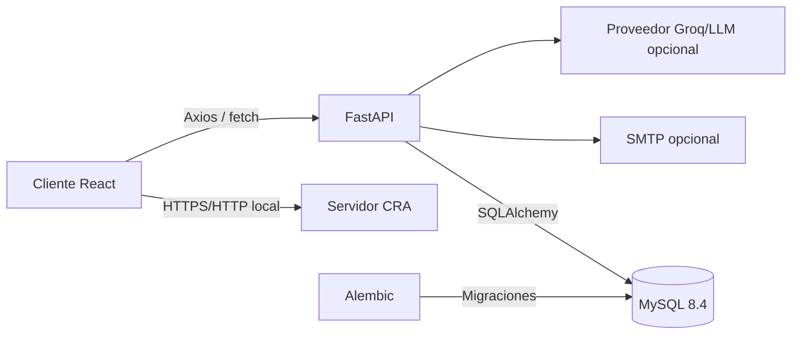

# Manual técnico único

## Arquitectura

El despliegue local usa `compose.yml`. Docker Compose crea MySQL, aplica migraciones y después
arranca el backend y el frontend.

## Componentes

| Componente | Ubicación | Responsabilidad |
| --- | --- | --- |
| Interfaz | `Frontend/src/App.js`, `Frontend/src/pages/` | Navegación, formularios y presentación |
| API | `Backend/main.py`, `Backend/routers/` | Contratos HTTP y casos de uso |
| Seguridad | `Backend/security.py` | Hash, JWT, roles y autorización |
| Modelos | `Backend/models.py` | Persistencia SQLAlchemy |
| Esquemas | `Backend/schemas.py` | Validación Pydantic |
| Migraciones | `Backend/alembic/` | Evolución controlada del esquema |
| Pruebas | `Backend/tests/`, `Frontend/src/**/*.test.js` | Automatización de regresión |

## Ejecución y seguridad

La aplicación exige secretos en entorno. Los valores de `.env` no se registran ni se incluyen en
imágenes. CORS acepta una lista explícita de orígenes y rechaza comodines. Las respuestas de API
añaden cabeceras de endurecimiento y no deben registrar contraseñas, tokens ni CVV.

## API

FastAPI genera OpenAPI en `/openapi.json` y documentación interactiva en `/docs`. La colección
exportable debe generarse con `/openapi.json` y revisarse contra routers, roles y errores.

## Operaciones

- Arranque: `docker compose up --build -d`
- Estado: `docker compose ps`
- Migraciones: ejecutar el servicio de migración incluido en Compose
- Salud: `/health/live` y `/health/ready`
- Respaldo: `scripts/backup-mysql.sh`
- Restauración: `scripts/restore-mysql.sh`
- Despliegue: workflow `/.github/workflows/release.yml`
