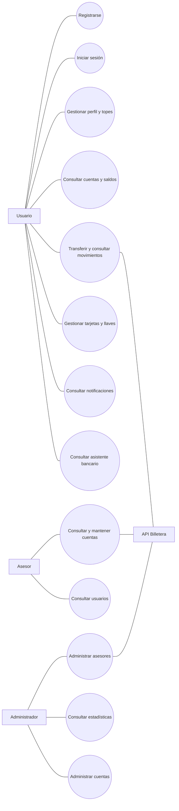
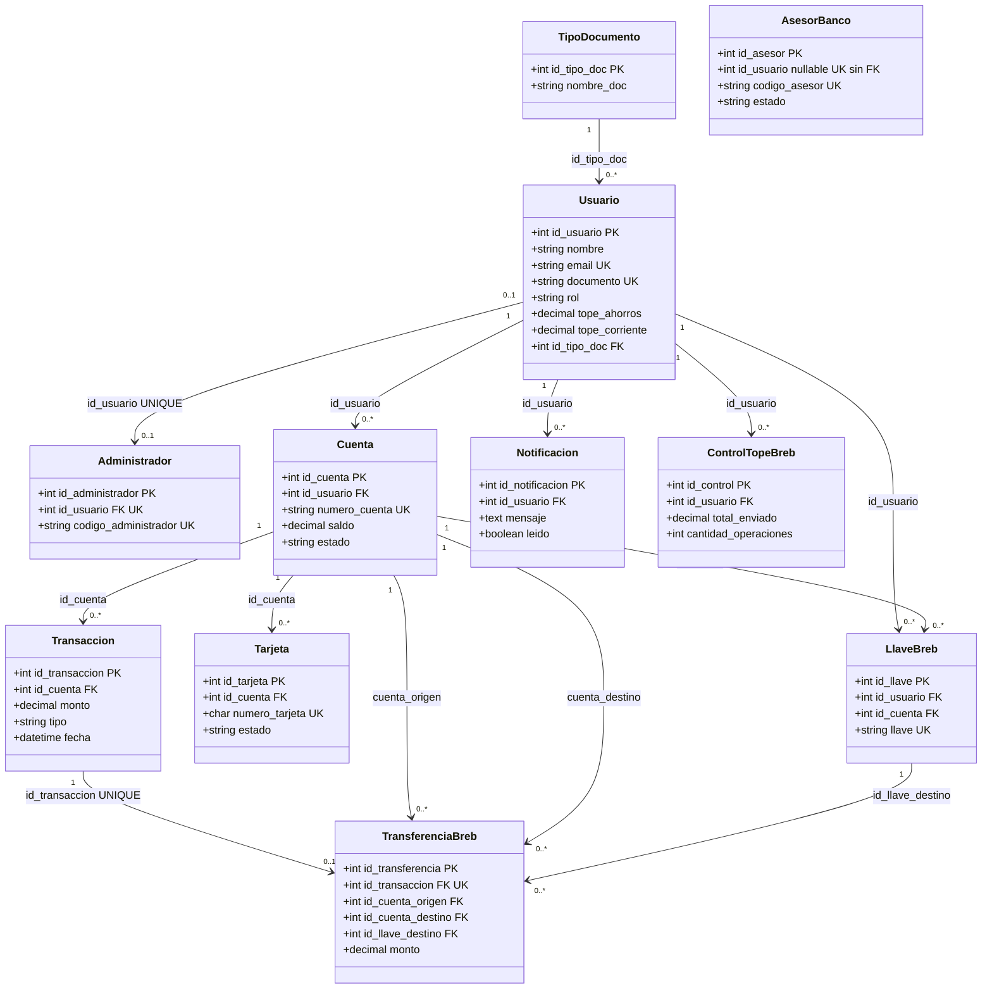
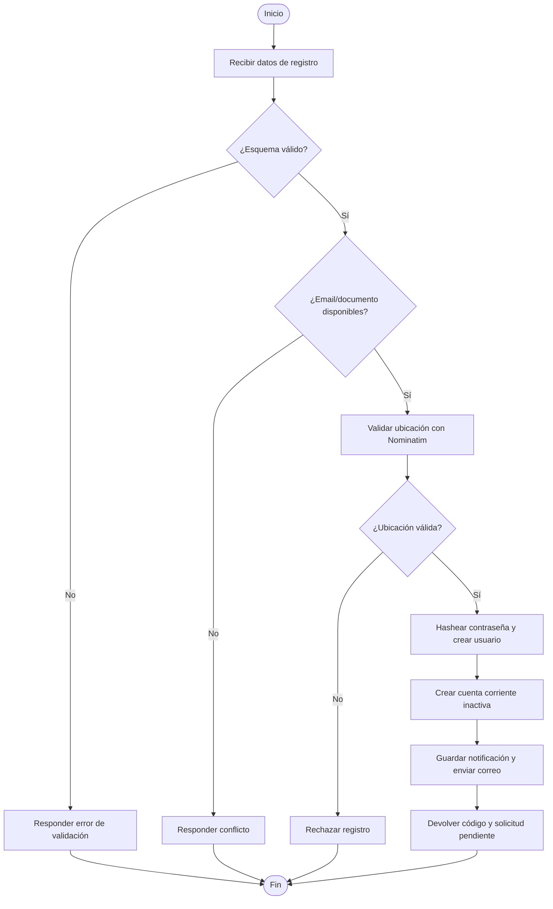
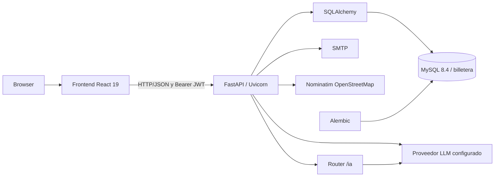
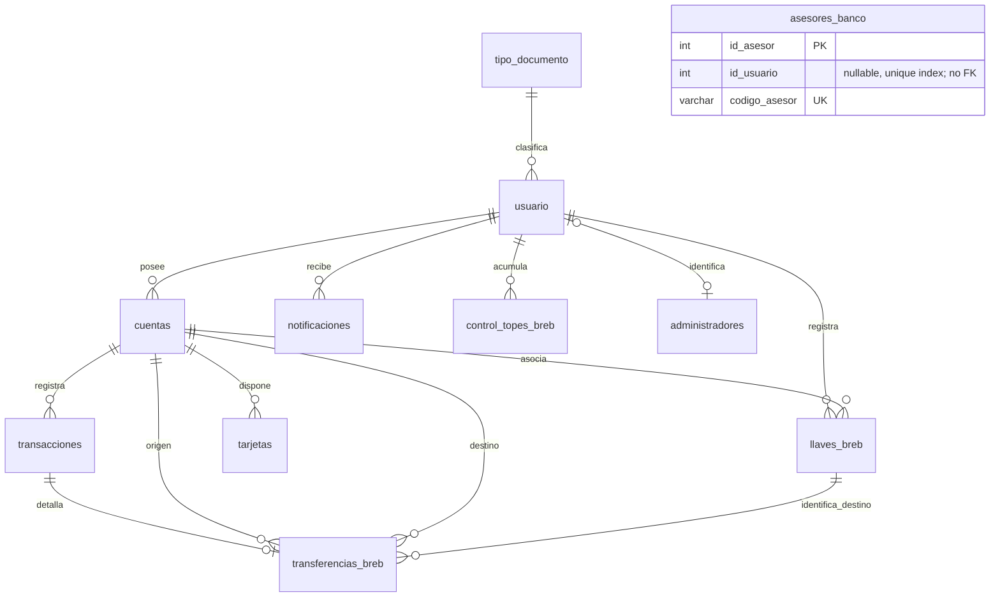

# MANUAL TÉCNICO DE LA APLICACIÓN BILLETERA

**Documento técnico de arquitectura, procesos, datos y operación**  
**Versión del documento:** 1.0  
**Fecha de elaboración:** 30 de octubre de 2026  
**Estado:** Elaboración inicial basada en el repositorio disponible  
**Proyecto:** Aplicación Billetera (nombre de la API: Financiero API)

> Documento académico de referencia técnica. No representa un acuerdo institucional ni un documento oficial del SENA.

## Tabla de contenido

1. [ALCANCE](#1-alcance)
2. [DESCRIPCIÓN DE LOS PROCESOS](#2-descripción-de-los-procesos)
3. [DIAGRAMAS UML](#3-diagramas-uml)
4. [MODELO RELACIONAL DE LA BASE DE DATOS](#4-modelo-relacional-de-la-base-de-datos)
5. [DESCRIPCIÓN DE LA PLATAFORMA](#5-descripción-de-la-plataforma)
6. [DOCUMENTACIÓN DEL CÓDIGO FUENTE](#6-documentación-del-código-fuente)
7. [DESCRIPCIÓN DE LOS ACUERDOS DE NIVELES DE SERVICIOS-ans](#7-descripción-de-los-acuerdos-de-niveles-de-servicios-ans)
8. [ADMINISTRACIÓN DE USUARIOS](#8-administración-de-usuarios)

## Introducción

Este manual describe la implementación examinada en el repositorio `financiero`: una interfaz web React, una API FastAPI y un esquema relacional SQLAlchemy/Alembic configurado para MySQL. La aplicación incorpora gestión de perfiles y cuentas, autenticación, movimientos, transferencias, tarjetas, notificaciones, administración/asesoría y un asistente bancario conectado a proveedores de modelos de lenguaje.

La documentación se contrastó con el código de `Backend/`, `Frontend/src/`, los manifiestos de dependencias, `compose.yml` y las revisiones Alembic. No se consultaron ni se reproducen valores de archivos `.env`. La conexión de base de datos de inspección no está disponible en esta sesión: el diccionario y los diagramas representan el esquema declarado por los modelos y las migraciones, no una comparación con una instancia activa. La existencia de datos, el estado real de las revisiones y cualquier diferencia del servidor quedan **pendientes de validar**.

La imagen de referencia suministrada describe la estructura esperada del manual; no es una captura funcional de Billetera. No se encontraron capturas de pantalla reales de la aplicación disponibles para incorporar. Las rutas, los nombres de archivos y las capacidades se documentan tal como aparecen en el código examinado, incluidas las partes que no están conectadas al flujo activo.

# 1. ALCANCE

## 1.1 Objetivo general

Documentar la arquitectura técnica y el comportamiento implementado de Billetera para facilitar su instalación, mantenimiento, comprensión de datos, operación y evolución controlada.

## 1.2 Objetivos específicos

- Identificar módulos, tecnologías, dependencias y puntos de entrada.
- Describir los procesos expuestos por la API y las pantallas principales del frontend.
- Registrar tablas, campos, tipos, claves, índices y relaciones declarados.
- Explicar autenticación, autorización, roles y administración de usuarios según el código.
- Separar los comportamientos existentes de las recomendaciones y de los aspectos pendientes de validación.

## 1.3 Descripción y funcionalidades cubiertas

Billetera ofrece una interfaz de finanzas personales con registro, consulta y actualización de perfil, cuentas corrientes y de ahorros, saldos e historial, transferencias entre cuentas propias y a otros usuarios, llaves y transferencias Bre-B, tarjetas, recuperación de credenciales, notificaciones y asistencia conversacional. La API incorpora operaciones para asesores y administradores, incluida la gestión de cuentas, usuarios, asesores, estados y datos de cuenta.

El backend también consulta ubicaciones mediante Nominatim de OpenStreetMap durante el registro. El asistente bancario usa configuración de proveedores LLM (primario y alternativo declarados en la configuración); la integración efectiva depende de credenciales y parámetros del entorno.

## 1.4 Límites y alcance técnico

- **Incluido:** código y configuración versionados en el repositorio, modelos ORM, migraciones Alembic, rutas FastAPI y páginas/componentes React presentes.
- **No verificado:** disponibilidad de una instalación activa, contenido actual de la base MySQL, datos productivos, secretos/configuración local, servicios SMTP/LLM activos, y cumplimiento normativo o de seguridad de producción.
- El nombre predeterminado de la base se configura como `billetera`, pero `DB_NAME` permite reemplazarlo.
- Las tablas `transferencias_breb` y `control_topes_breb` están declaradas en el esquema; en el proceso visible de `/transferencias/bre-b` no se encontró inserción en esas tablas. La ruta sí modifica saldos y registra movimientos en `transacciones`.
- El tope de ahorro y corriente se almacena en el usuario, se actualiza desde el perfil propio y la ruta Bre-B compara el monto individual contra el tope correspondiente. No se encontró un acumulado diario implementado en `control_topes_breb`.
- No se identificó un endpoint de baja/eliminación de usuarios comunes. Sí hay rutas de eliminación para asesores y tarjetas.
- `Backend/auth/auth.py` y `Backend/base de datos billetera/bd.py` no son dependencias importadas por el punto de entrada FastAPI documentado; se consideran archivos heredados/no conectados al flujo API activo, no la implementación operativa de autenticación.
- El entorno Compose arranca React en modo desarrollo y Uvicorn con `--reload`; no se encontró configuración de proxy inverso ni despliegue de producción.

## 1.5 Actores identificados

| Actor | Responsabilidad observada |
|---|---|
| Usuario | Registrarse, consultar su perfil y cuentas, transferir, administrar llaves, consultar movimientos/notificaciones, tarjetas y solicitar asistencia. |
| Asesor | Consultar usuarios/cuentas, intervenir en activación y mantenimiento de cuentas, y administrar determinadas operaciones de usuarios. |
| Administrador | Administrar asesores, consultar usuarios/cuentas/estadísticas y realizar acciones administrativas de cuenta. |
| Servicios externos | SMTP para correos, Nominatim para comprobación de ubicación y proveedor LLM para el asistente. |

# 2. DESCRIPCIÓN DE LOS PROCESOS

Las entradas se validan principalmente mediante esquemas Pydantic y comprobaciones de cada ruta. En las operaciones de base de datos, los cambios se confirman con `commit()`; algunos flujos transaccionales revierten con `rollback()` ante errores.

## 2.1 Registro de usuario

- **Objetivo:** crear un usuario y dejar una cuenta corriente pendiente de aprobación.
- **Actor:** persona solicitante; el endpoint es `POST /register`.
- **Entradas:** nombre, email, documento, contraseña, teléfono, tipo de documento, dirección, ciudad, localidad, barrio y código de correspondencia.
- **Validaciones:** esquema Pydantic; formato de email; longitudes y patrón numérico del documento/código postal; email/documento no duplicados; tipo documental permitido (`cc`, `ti`, `ce`); comprobación de ubicación real a través de Nominatim.
- **Procedimiento:** busca o crea `tipo_documento`; genera código de registro y número de cuenta; almacena contraseña mediante `hash_password`; crea usuario, cuenta corriente con saldo cero y estado `inactiva`, notificación y correo informativo.
- **Resultado esperado:** respuesta con mensaje, código de registro e identificador/nombre/rol; aprobación de cuenta requerida antes del acceso normal.
- **Errores observables:** duplicados `409`, ubicación o tipo inválido `400`; el servicio externo de ubicación tiene timeout de cinco segundos y ante excepción la validación falla.

## 2.2 Registro de asesor

- **Objetivo:** registrar una cuenta con rol de asesor.
- **Actor:** asesor autorizado; `POST /register-asesor`.
- **Entradas y validaciones:** los datos del registro de usuario más el código de autorización de asesor configurado como `ASESOR_REGISTRATION_CODE`; comparación de código con `hmac.compare_digest`.
- **Procedimiento:** reutiliza el alta de usuario con rol `asesor`, crea una fila `asesores_banco` activa con código generado, crea cuenta corriente inactiva y notificación.
- **Resultado:** registro creado; el registro del asesor responde `503` si no está configurado el código y `403` si no coincide.

## 2.3 Inicio de sesión, verificación y cierre

### Usuario

- **Objetivo:** autenticar a un usuario habilitado.
- **Actor:** usuario; `POST /login`.
- **Entrada:** documento, contraseña y rol solicitado (`usuario` o `asesor`).
- **Validaciones:** existencia, hash de contraseña, correspondencia de rol; asesor activo en `asesores_banco`; usuario regular con al menos una cuenta activa; email disponible.
- **Procedimiento:** genera JWT con expiración de 60 minutos, genera código de verificación de cuatro dígitos, envía correo de acceso y aviso de inicio de sesión, y registra notificación.
- **Resultado:** devuelve token, rol/identidad y código de verificación junto con el mensaje. El código también es comparado por el cliente web; no se encontró una ruta backend separada que consuma ese código para habilitar el token.

### Asesor y administrador

- **Asesor:** `POST /asesor-login` valida email, código único y estado activo, envía código al correo y devuelve JWT; admite asesores vinculados a usuario y registros independientes.
- **Administrador:** `POST /administrador-login` valida documento y código de administrador asociado, envía código y devuelve JWT.
- **Resultado/error:** ante correo no configurado o fallo SMTP, el backend responde `503`; credenciales no válidas generan respuestas de autenticación/rechazo.

### Cierre de sesión

No se encontró endpoint de cierre de sesión ni lista de revocación en servidor. El frontend expone una operación local que elimina `token` y `user` de `localStorage`; el JWT ya emitido permanece válido hasta expirar.

## 2.4 Recuperación de contraseña

- **Objetivo:** permitir restablecer la contraseña tras verificaciones encadenadas.
- **Actor:** titular de la cuenta.
- **Entradas:** documento y email; luego código de seis dígitos; luego últimos dígitos, vencimiento y código de seguridad de tarjeta; finalmente contraseña nueva.
- **Validaciones:** coincidencia documento/email, código con expiración de diez minutos y máximo cinco intentos, token temporal y verificación de tarjeta; contraseña nueva de 8 a 128 caracteres.
- **Procedimiento:** el estado de recuperación se mantiene en `codigos_recuperacion`, una estructura en memoria del proceso; se envía el código por email, se verifica la tarjeta y se guarda el nuevo hash.
- **Resultado:** contraseña actualizada. La recuperación pendiente desaparece si se reinicia el proceso y no se comparte entre réplicas.

## 2.5 Autenticación y autorización

- **Objetivo:** identificar la cuenta en rutas protegidas y limitar operaciones por rol.
- **Mecanismo:** `HTTPBearer`; JWT firmado HS256, sujeto de usuario y duración de 60 minutos.
- **Validaciones:** firma, expiración y presencia de `sub`; dependencias `token_required`, `asesor_requerido` y `administrador_o_asesor_requerido`.
- **Resultado:** usuario autenticado disponible para la ruta; respuesta `401` si token inválido/expirado, `403` si rol insuficiente.
- **Observación:** la clave de firma está definida estáticamente en el módulo de seguridad; el valor no se reproduce en este manual. Debe externalizarse y rotarse antes de un despliegue real. FastAPI configura CORS con origen comodín y credenciales habilitadas; validar esta política antes de producción.

## 2.6 Administración de usuarios y asesores

- **Objetivo:** consultar y mantener usuarios/clientes y asesores.
- **Actor:** administrador o asesor según la ruta.
- **Entradas:** filtros de paginación (`limite` hasta 100 y cursor), campos de perfil, datos del asesor, estado y códigos de administración.
- **Validaciones:** rol desde dependencia, validación Pydantic, email/documento únicos donde aplica, longitud mínima de nombre y formato de datos; errores explícitos para usuario/asesor inexistente o código inválido.
- **Procedimiento:** `GET /usuarios` lista usuarios de rol usuario; `GET /administradores/cuentas` y `/administradores/estadisticas` exponen consultas administrativas; `PUT /usuarios/{id_usuario}/perfil` permite a un asesor actualizar datos de cliente; endpoints `/administradores/asesores` permiten crear, consultar, modificar, eliminar y regenerar código.
- **Resultado:** consulta o persistencia del perfil/asesor.
- **Límite:** no se identificó una ruta de alta administrativa, desactivación o eliminación de usuarios comunes. La modificación propia de perfil usa `PUT /usuario/perfil`.

## 2.7 Gestión de cuentas

- **Objetivo:** administrar productos corrientes/ahorros, su saldo, estado, numeración y tipo de operación.
- **Actores:** cliente consulta sus cuentas; administrador/asesor crea o mantiene cuentas.
- **Entradas:** titular, tipo de cuenta (`ahorros`, `corriente`), tipo operativo (`debito`, `credito`), saldo y, en acciones administrativas, códigos de autorización o últimos cuatro dígitos.
- **Validaciones:** tipos enumerados, saldo no negativo, existencia y rol del titular, cuenta no duplicada por tipo en el alta observada, cuenta activa para operaciones financieras; número de cuenta de 16 dígitos y últimos dígitos numéricos/unívocos.
- **Procedimiento:** el registro crea cuenta corriente inactiva; un asesor puede consultar y habilitar/deshabilitar cuentas; administradores/asesores pueden modificar saldo/tipo según sus rutas. La administración incluye cambios de débito/crédito y últimos dígitos.
- **Resultado:** cuenta consultada, creada o actualizada; la activación es necesaria para operaciones permitidas.

## 2.8 Transacciones y movimientos financieros

- **Objetivo:** consultar y registrar movimientos y transferencias.
- **Actores:** usuario autenticado.
- **Entradas:** cuenta origen, destino, monto positivo y descripción opcional; Bre-B usa llave destino.
- **Validaciones:** monto mayor que cero, cuentas existentes/activas, saldo suficiente, destino distinto de la cuenta/usuario de origen y llave Bre-B activa; transferencia propia requiere dos cuentas activas de tipos distintos.
- **Procedimiento:** bloquea las filas de cuenta con `with_for_update()` en las transferencias observadas, debita origen, acredita destino, inserta movimientos `Transferencia`/`Ingreso` y confirma el cambio. `/transacciones` lista movimientos del usuario por fecha descendente.
- **Resultado:** nuevos saldos y movimientos persistidos; ante fallo en las rutas con manejo transaccional se revierte la sesión.
- **Límite:** no se documenta como contabilidad bancaria externa ni integración con una red de pagos real; Bre-B se implementa dentro de las cuentas de la aplicación.

## 2.9 Topes de ahorro y corriente

- **Objetivo:** definir restricciones monetarias por tipo de cuenta para transferencias Bre-B.
- **Actor:** usuario autenticado.
- **Entradas:** `tope_ahorros` y `tope_corriente` desde `PUT /usuario/perfil`, acompañados por contraseña actual.
- **Validaciones:** Pydantic exige valores decimales no negativos; se verifica la contraseña actual.
- **Procedimiento:** el perfil guarda los dos valores en `usuario`. En `/transferencias/bre-b` se compara el monto de esa transferencia con el tope de la cuenta origen cuando el valor es mayor que cero.
- **Resultado:** el monto individual que supera el tope se rechaza; cero no impone límite en la condición visible.
- **Límite:** no se encontró ventana temporal, contador aplicado ni actualización desde las rutas de `control_topes_breb`. No describir estos campos como un límite diario implementado.

## 2.10 Llaves Bre-B, tarjetas y notificaciones

- **Llaves:** el usuario autenticado registra o actualiza llave asociada a una cuenta activa; las llaves deben ser únicas y activas para consulta/transferencia.
- **Tarjetas:** existen rutas de consulta, alta, cambio de estado, eliminación y bloqueo/desbloqueo vinculadas a cuentas. La recuperación también compara los datos de tarjeta contra el registro.
- **Notificaciones:** el usuario puede listar, marcar como leídas y eliminar una o todas sus notificaciones.
- **Validaciones/resultados:** se comprueba titularidad/estado según cada ruta; la respuesta informa el estado actualizado. La tabla almacena número, vencimiento y código de seguridad; la implementación no muestra cifrado de estos campos.

## 2.11 Asistente, ubicaciones y reportes

- **Asistente:** `POST /ia/chat` exige JWT y mensaje de 1–4000 caracteres; conserva hasta seis turnos previos válidos de usuario/asistente, llama al proveedor configurado y limita la respuesta a 300 caracteres. Fallos de proveedor producen error de servicio `502`.
- **Ubicaciones:** `GET /ubicaciones` consulta `ubicacionesPorCiudad`; esta tabla no figura entre las tablas creadas por la migración inicial disponible, por lo que su aprovisionamiento queda pendiente de validar.
- **Reportes:** hay endpoint `POST /reportes/transaccion-fallida`; se identifica como reporte de incidente/operación, no como módulo analítico completo.

# 3. DIAGRAMAS UML

Los diagramas editables están en [`diagramas/`](./diagramas/). Mermaid constituye la fuente portable; las relaciones ER dibujadas representan claves foráneas declaradas, no relaciones inferidas por nombre.

## 3.1 Diagrama de casos de uso

Fuente: [`casos_uso.mmd`](./diagramas/casos_uso.mmd).



## 3.2 Diagrama de clases / entidades

Fuente: [`clases.mmd`](./diagramas/clases.mmd). Para evitar confundir una convención de datos con una clave, solo se representan asociaciones respaldadas por FK.



`AsesorBanco.id_usuario` tiene índice único, pero no FK en el DDL examinado; por eso no se dibuja como asociación referencial.

## 3.3 Diagrama de secuencia: transferencia propia

Fuente: [`secuencia_transferencia.mmd`](./diagramas/secuencia_transferencia.mmd).

```mermaid
sequenceDiagram
  actor U as Usuario
  participant F as Frontend React
  participant A as FastAPI /transferencias/entre-cuentas
  participant S as SQLAlchemy
  participant D as MySQL billetera
  U->>F: Selecciona origen, destino y monto
  F->>A: POST con Bearer JWT y datos
  A->>A: Valida identidad, tipos y monto > 0
  A->>D: Busca y bloquea cuentas activas del usuario
  D-->>A: Cuenta origen/destino y saldos
  A->>A: Verifica saldo; debita y acredita
  A->>D: Inserta movimientos de salida/entrada
  A->>D: COMMIT
  D-->>A: Confirmación
  A-->>F: Saldos resultantes
  F-->>U: Presenta resultado
```

## 3.4 Diagrama de actividades: registro

Fuente: [`actividad_registro.mmd`](./diagramas/actividad_registro.mmd).



## 3.5 Diagrama de componentes

Fuente: [`componentes.mmd`](./diagramas/componentes.mmd).



# 4. MODELO RELACIONAL DE LA BASE DE DATOS

## 4.1 Identificación y fuentes

| Elemento | Evidencia |
|---|---|
| Nombre predeterminado | `billetera` (`DB_NAME` en `compose.yml`, con posibilidad de sobrescritura). |
| SGBD configurado | Imagen `mysql:8.4`; conexión SQLAlchemy `mysql+pymysql`. |
| Fuente del esquema | `Backend/models.py` y tres revisiones `Backend/alembic/versions/`. |
| Inspección del servidor | No disponible en esta sesión: el cliente de base de datos no encontró conexión configurada. Comparación runtime pendiente. |
| Total de tablas declaradas | 11 en la revisión inicial/modelos. |

## 4.2 Diagrama entidad-relación

Fuente: [`modelo_relacional.mmd`](./diagramas/modelo_relacional.mmd).



## 4.3 Modelo relacional y relaciones

- `tipo_documento (1) — (N) usuario`, mediante `usuario.id_tipo_doc`.
- `usuario (1) — (N) cuentas`, `notificaciones`, `llaves_breb` y `control_topes_breb`.
- `usuario — administradores`: `administradores.id_usuario` es nullable y único; la migración declara FK.
- `cuentas (1) — (N) transacciones`, `tarjetas` y `llaves_breb`.
- `transacciones (1) — (0..1) transferencias_breb`: `id_transaccion` es FK y único.
- `transferencias_breb` referencia cuenta origen, cuenta destino y llave destino.
- `asesores_banco.id_usuario` no tiene FK en el esquema migrado; su índice único no garantiza integridad referencial.
- No se declararon acciones `ON DELETE CASCADE` en las FK del DDL inicial. Los `cascade="all, delete-orphan"` en algunas relaciones son configuración ORM, no una cláusula de cascada declarada por la migración.

## 4.4 Diccionario de datos

Abreviaturas: **PK** clave primaria; **FK** clave foránea; **UQ** restricción/índice único; **NN** no nulo. Los tipos y nulabilidad reflejan la migración inicial; los valores predeterminados indicados son los declarados en modelos/migración.

### `tipo_documento`

| Campo | Tipo | Nulo | Clave / regla |
|---|---|---:|---|
| `id_tipo_doc` | INT | No | PK; índice `ix_tipo_documento_id_tipo_doc` |
| `nombre_doc` | VARCHAR(50) | No | Nombre del tipo documental |

### `usuario`

| Campo | Tipo | Nulo | Clave / regla |
|---|---|---:|---|
| `id_usuario` | INT | No | PK; índice `ix_usuario_id_usuario` |
| `nombre` | VARCHAR(100) | No | Nombre |
| `email` | VARCHAR(100) | No | UQ; índice `ix_usuario_email` |
| `password` | VARCHAR(255) | No | Hash de contraseña |
| `telefono` | VARCHAR(20) | Sí | Teléfono |
| `direccion` | VARCHAR(200) | Sí | Dirección |
| `codigo_postal` | VARCHAR(6) | Sí | Código de correspondencia |
| `ciudad` | VARCHAR(100) | Sí | Ciudad |
| `localidad` | VARCHAR(100) | Sí | Localidad |
| `barrio` | VARCHAR(100) | Sí | Barrio |
| `llave_bre_b` | VARCHAR(100) | Sí | UQ |
| `documento` | VARCHAR(50) | Sí | UQ |
| `rol` | VARCHAR(20) | No | Default `usuario` |
| `codigo_registro` | VARCHAR(6) | Sí | UQ; índice `codigo_registro` |
| `estado` | VARCHAR(20) | No | Default `activo` |
| `tope_ahorros` | DECIMAL(15,2) | No | Default 0.00 |
| `tope_corriente` | DECIMAL(15,2) | No | Default 0.00 |
| `fecha_creacion` | DATETIME | Sí | Valor predeterminado en ORM |
| `id_tipo_doc` | INT | Sí | FK → `tipo_documento.id_tipo_doc` |

Índice compuesto: `ix_usuario_rol_id_usuario` (`rol`, `id_usuario`), no único.

### `administradores`

| Campo | Tipo | Nulo | Clave / regla |
|---|---|---:|---|
| `id_administrador` | INT | No | PK |
| `id_usuario` | INT | Sí | FK → `usuario.id_usuario`; UQ |
| `codigo_administrador` | VARCHAR(30) | No | UQ |
| `fecha_ingreso` | DATETIME | No | Default `CURRENT_TIMESTAMP` |

### `asesores_banco`

| Campo | Tipo | Nulo | Clave / regla |
|---|---|---:|---|
| `id_asesor` | INT | No | PK |
| `id_usuario` | INT | Sí | Índice único `id_usuario`; **no es FK** |
| `nombre` | VARCHAR(100) | Sí | Nombre |
| `documento` | VARCHAR(50) | Sí | Documento |
| `tipo_documento` | VARCHAR(50) | Sí | Tipo documental como texto |
| `email` | VARCHAR(100) | Sí | Email |
| `codigo_asesor` | VARCHAR(30) | No | UQ |
| `especialidad` | VARCHAR(100) | Sí | Especialidad |
| `estado` | ENUM('activo','inactivo') | No | Default `activo` |
| `fecha_ingreso` | DATETIME | No | Default `CURRENT_TIMESTAMP` |

### `cuentas`

| Campo | Tipo | Nulo | Clave / regla |
|---|---|---:|---|
| `id_cuenta` | INT | No | PK; índice `ix_cuentas_id_cuenta` |
| `numero_cuenta` | VARCHAR(16) | Sí | UQ; índice `numero_cuenta` |
| `id_usuario` | INT | No | FK → `usuario.id_usuario` |
| `tipo_cuenta` | ENUM('ahorros','corriente') | No | Tipo de producto |
| `tipo_operacion` | ENUM('debito','credito') | No | Default `debito` |
| `saldo` | DECIMAL(15,2) | Sí | Saldo |
| `estado` | ENUM('activa','inactiva','bloqueada') | Sí | Estado |
| `fecha_estado` | DATETIME | Sí | Fecha de estado |

### `transacciones`

| Campo | Tipo | Nulo | Clave / regla |
|---|---|---:|---|
| `id_transaccion` | INT | No | PK; índice `ix_transacciones_id_transaccion` |
| `id_cuenta` | INT | No | FK → `cuentas.id_cuenta` |
| `monto` | DECIMAL(15,2) | No | Monto |
| `tipo` | ENUM('Ingreso','Gasto','Transferencia') | No | Clasificación |
| `fecha` | DATETIME | Sí | Valor predeterminado en ORM |
| `descripcion` | TEXT | Sí | Descripción |

### `notificaciones`

| Campo | Tipo | Nulo | Clave / regla |
|---|---|---:|---|
| `id_notificacion` | INT | No | PK; índice `ix_notificaciones_id_notificacion` |
| `id_usuario` | INT | No | FK → `usuario.id_usuario` |
| `mensaje` | TEXT | No | Contenido |
| `leido` | BOOLEAN | Sí | Estado de lectura |
| `fecha` | DATETIME | Sí | Valor predeterminado en ORM |

### `tarjetas`

| Campo | Tipo | Nulo | Clave / regla |
|---|---|---:|---|
| `id_tarjeta` | INT | No | PK; índice `ix_tarjetas_id_tarjeta` |
| `id_cuenta` | INT | No | FK → `cuentas.id_cuenta` |
| `numero_tarjeta` | CHAR(16) | Sí | UQ |
| `fecha_expiracion` | CHAR(5) | Sí | Fecha de expiración |
| `codigo_seguridad` | CHAR(4) | Sí | Código de seguridad |
| `estado` | ENUM('activa','bloqueada','expirada') | Sí | Estado |

### `llaves_breb`

| Campo | Tipo | Nulo | Clave / regla |
|---|---|---:|---|
| `id_llave` | INT | No | PK; índice `ix_llaves_breb_id_llave` |
| `id_usuario` | INT | No | FK → `usuario.id_usuario` |
| `id_cuenta` | INT | No | FK → `cuentas.id_cuenta` |
| `tipo_llave` | ENUM('documento','celular','correo','alfanumerica') | No | Tipo |
| `llave` | VARCHAR(100) | No | Índice único `ix_llaves_breb_llave` |
| `estado` | ENUM('activa','inactiva') | No | Estado |
| `fecha_creacion` | DATETIME | Sí | Valor predeterminado en ORM |

### `transferencias_breb`

| Campo | Tipo | Nulo | Clave / regla |
|---|---|---:|---|
| `id_transferencia` | INT | No | PK; índice `ix_transferencias_breb_id_transferencia` |
| `id_transaccion` | INT | No | FK → `transacciones.id_transaccion`; UQ |
| `id_cuenta_origen` | INT | No | FK → `cuentas.id_cuenta` |
| `id_cuenta_destino` | INT | No | FK → `cuentas.id_cuenta` |
| `id_llave_destino` | INT | No | FK → `llaves_breb.id_llave` |
| `monto` | DECIMAL(15,2) | No | Monto |
| `descripcion` | VARCHAR(255) | Sí | Descripción |
| `estado` | ENUM('pendiente','procesada','rechazada','cancelada') | No | Estado |
| `referencia` | VARCHAR(100) | No | Índice único `ix_transferencias_breb_referencia` |
| `fecha_transferencia` | DATETIME | Sí | Valor predeterminado en ORM |

### `control_topes_breb`

| Campo | Tipo | Nulo | Clave / regla |
|---|---|---:|---|
| `id_control` | INT | No | PK; índice `ix_control_topes_breb_id_control` |
| `id_usuario` | INT | No | FK → `usuario.id_usuario` |
| `fecha` | DATETIME | Sí | Valor predeterminado en ORM |
| `total_enviado` | DECIMAL(15,2) | No | Valor inicial ORM 0 |
| `cantidad_operaciones` | INT | No | Contador |

## 4.5 Restricciones e índices

- Claves primarias: columna `id_*` de cada una de las once tablas.
- Unicidad declarada: `usuario.email`, `usuario.documento`, `usuario.llave_bre_b`, `usuario.codigo_registro`, `administradores.id_usuario`, `administradores.codigo_administrador`, `asesores_banco.id_usuario` (índice único), `asesores_banco.codigo_asesor`, `cuentas.numero_cuenta`, `tarjetas.numero_tarjeta`, `llaves_breb.llave`, `transferencias_breb.id_transaccion` y `transferencias_breb.referencia`.
- FKs: las identificadas en el apartado 4.3; no se configuraron reglas explícitas de cascada en la migración inicial.
- Enumeraciones controladas: estados/tipos de cuenta, operación, tarjeta, asesor, llave, transferencia y transacción.
- Índice de búsqueda/paginación: `usuario(rol, id_usuario)`.
- La revisión `f7c2d5b184a0` normaliza registros anteriores y genera números de cuenta faltantes; su `downgrade()` no revierte esos datos. La revisión `c4c18e9fa82b` añade el índice de listado.

# 5. DESCRIPCIÓN DE LA PLATAFORMA

## 5.1 Tecnologías verificadas

| Capa | Tecnología y evidencia |
|---|---|
| Lenguaje backend | Python; imagen `python:3.12-slim` en `Backend/Dockerfile`. |
| Framework backend | FastAPI; ASGI servido por Uvicorn. |
| Modelado/validación | SQLAlchemy ORM, Pydantic 2 y pydantic-settings. |
| Migraciones | Alembic. |
| Controlador MySQL | PyMySQL. |
| Lenguaje frontend | JavaScript/JSX. |
| Framework frontend | React; lockfile verifica React y React DOM 19.3.1. |
| Rutas UI | React Router DOM 7.18.4 (lockfile). |
| Peticiones HTTP | Axios; también hay llamadas `fetch` nativas. |
| Base de datos | MySQL 8.4 declarado en Compose; SQLite `./billetera.db` como fallback cuando no están las variables DB. |
| Servidor frontend | `react-scripts start` (Create React App) en contenedor Node 22. |
| Servidor API | Uvicorn, puerto de contenedor 8000, recarga habilitada en Compose. |
| Correo | SMTP con STARTTLS; host predeterminado en el servicio de correo. |
| IA | SDK Groq y cliente HTTPX; se declaran URLs/modelos configurables para proveedor principal/alternativo. |
| Contenedores | Docker Compose; MySQL expuesto en host 3307, API 8000 y frontend 3000. |

Versiones exactas solo se afirman cuando el Dockerfile o lockfile las fija. En `Backend/requirements.txt` varias dependencias usan rangos abiertos, por lo que no se asigna versión instalada sin un entorno reproducible.

## 5.2 Dependencias principales

**Backend:** FastAPI, Pydantic, pydantic-settings, SQLAlchemy, Alembic, PyMySQL, python-jose, passlib (Argon2/bcrypt), python-multipart, python-dotenv, cryptography, httpx, LangChain, FAISS, tiktoken, OpenAI y Groq.

**Frontend (lockfile):** React, React DOM, React Router DOM, Axios, Chart.js, Firebase, Express, cors, mysql2, html2canvas, html2pdf.js, jsPDF y react-scripts. La presencia de paquetes en el manifiesto no implica que cada dependencia esté conectada a una funcionalidad del servidor activo.

## 5.3 Requisitos y configuración

- **Contenedores:** Docker compatible con Compose; `compose.yml` define base de datos, backend y frontend, además de un volumen persistente MySQL.
- **Desarrollo fuera de contenedores:** Python 3.12 como versión del contenedor backend; Node 22 como versión del contenedor frontend.
- **Variables de entorno:** `MYSQL_ROOT_PASSWORD` y `MYSQL_APP_PASSWORD` son obligatorias para Compose; `DB_NAME` y `MYSQL_APP_USER` tienen valores predeterminados declarados. La API usa `DB_HOST`, `DB_PORT`, `DB_USER`, `DB_PASSWORD`, `DB_NAME` o `DATABASE_URL`. No se reproducen valores secretos.
- **Integraciones opcionales:** claves de proveedor LLM, autorización de registro de asesor y credenciales/host SMTP. Configurar según el servicio requerido.
- **Arranque de desarrollo:** desde la raíz, `docker compose up -d --build`; interfaz `http://localhost:3000`, API `http://localhost:8000` y documentación OpenAPI generada por FastAPI en `/docs`.
- **Persistencia:** volumen Docker `mysql_data`. No eliminarlo para reiniciar servicios si deben conservarse datos.
- No se encontró configuración de servidor web de producción, TLS, proxy inverso, respaldo automático programado ni monitoreo de disponibilidad.

## 5.4 Requisitos mínimos

El repositorio no fija requisitos mínimos de hardware. Como **propuesta inicial de desarrollo**, no como requisito probado: equipo de 4 núcleos, 8 GB de RAM y 10 GB libres para imágenes, dependencias y volúmenes; Docker Desktop/Engine compatible con Compose. Ajustar según concurrencia, datos y ambiente destino.

## 5.5 Consideraciones de seguridad y operación

El código usa Argon2/bcrypt para contraseñas y JWT HS256; el token se conserva en `localStorage`. La clave de firma aparece como constante en el backend. El código de OTP se incluye en la respuesta de login y el control comparativo está en el cliente, por lo que la verificación no queda validada exclusivamente por el servidor. La tabla de tarjeta almacena datos de tarjeta y el módulo de recuperación los compara; confirmar medidas de protección/cumplimiento antes de producción. Revisar además CORS comodín, URLs locales del frontend y servidores de desarrollo/recarga antes de exponer la aplicación.

# 6. DOCUMENTACIÓN DEL CÓDIGO FUENTE

## 6.1 Estructura

| Ubicación | Responsabilidad |
|---|---|
| `Backend/` | API FastAPI, persistencia, autenticación, esquemas, servicios, migraciones y pruebas. |
| `Backend/alembic/` | Entorno y revisiones de cambios del esquema. |
| `Backend/ai/` | Router, configuración, preparación de historial, prompt y clientes LLM. |
| `Backend/database/` | Motor SQLAlchemy, sesión y clase `Base`. |
| `Backend/email_service/` | Plantilla HTML, lectura de credenciales SMTP y envío de mensajes. |
| `Backend/routers/` | Router modular de asesor bancario, además de otros routers específicos. |
| `Backend/tests/` | Pruebas automatizadas de endpoints, reglas y esquemas. |
| `Frontend/src/pages/` | Vistas de usuario, cuentas, autenticación, historial y administración. |
| `Frontend/src/components/`, `layouts/` | Componentes y composición visual. |
| `Frontend/src/context/`, `hooks/` | Estado de autenticación/tema y hooks. |
| `Frontend/src/services/` | Clientes/servicios HTTP y autenticación auxiliar. |
| `Frontend/src/routes/` | Definiciones de rutas alternativas/privadas. |
| `Frontend/src/utils/`, `styles/`, `assets/` | Validaciones/utilidades, CSS y recursos. |
| `scripts/` | Utilidades del repositorio (por ejemplo, respaldo). |

## 6.2 Archivos principales

| Nombre | Ubicación | Lenguaje | Responsabilidad | Funcionalidad |
|---|---|---|---|---|
| `main.py` | `Backend/main.py` | Python | Punto de entrada FastAPI | Rutas de cuentas, auth, perfiles, movimientos, tarjetas y Bre-B. |
| `models.py` | `Backend/models.py` | Python | Entidades SQLAlchemy | Tablas y asociaciones ORM del esquema de aplicación. |
| `schemas.py` | `Backend/schemas.py` | Python | Contratos de entrada/salida | Validación de campos, tipos, longitudes y valores permitidos. |
| `security.py` | `Backend/security.py` | Python | Seguridad de backend | Hash/verificación, JWT y dependencia Bearer. |
| `database.py` | `Backend/database/database.py` | Python | Configuración de DB | Selección URL, engine, `SessionLocal` y `Base`. |
| `dependencias.py` | `Backend/dependencias.py` | Python | Dependencias FastAPI | Provee y cierra sesiones de base de datos. |
| `env.py` | `Backend/alembic/env.py` | Python | Integración Alembic | Usa metadatos/modelos al generar/aplicar revisiones. |
| Revisiones Alembic | `Backend/alembic/versions/` | Python | Evolución del esquema | Esquema inicial, normalización e índice compuesto de usuarios. |
| `email_service.py` | `Backend/email_service/email_service.py` | Python | Integración SMTP | Construye plantillas y envía correos STARTTLS. |
| `router.py` | `Backend/ai/router.py` | Python | API conversacional | Valida solicitudes y exige JWT para `/ia/chat`. |
| `chains.py`, `llm.py`, `config.py` | `Backend/ai/` | Python | Lógica de IA | Normaliza contexto, consulta proveedor y maneja fallos/configuración. |
| `breb.py` | `Backend/routers/breb.py` | Python | Rutas auxiliares Bre-B | Consultas y cambios de estado de cuentas; algunas rutas no declaran auth propia. |
| `requirements.txt` | `Backend/requirements.txt` | Texto | Dependencias Python | Rangos de paquetes del backend. |
| `Dockerfile` | `Backend/Dockerfile` | Dockerfile | Imagen de API | Instala dependencias y ejecuta Uvicorn. |
| `compose.yml` | Raíz | YAML | Orquestación local | MySQL, backend, frontend, volúmenes, healthcheck y puertos. |
| `App.js`, `index.js` | `Frontend/src/` | JavaScript/JSX | Entrada de UI | Renderiza la aplicación y configura URL API/interceptores. |
| `pages/*.jsx` | `Frontend/src/pages/` | JavaScript/JSX | Pantallas | Registro, login, cuenta, transferencias, historial, admin y más. |
| `services/api.js` | `Frontend/src/services/` | JavaScript | Cliente Axios | Define base URL auxiliar de API. |
| `package.json` | `Frontend/` | JSON | Dependencias/scripts frontend | Scripts `start`, `build`, `test`, `eject`. |
| `tests/*.py` | `Backend/tests/` | Python | Pruebas | Verifica reglas, rutas, modelos y errores seleccionados. |

## 6.3 Conexión a datos y errores

`Backend/database/database.py` carga el entorno, prioriza `DATABASE_URL`, compone URL MySQL con las variables DB y usa SQLite local como alternativa si faltan. El engine configura `pool_pre_ping`, tamaño del pool y tiempos ajustables. `get_db()` abre una sesión por petición y la cierra en `finally`.

FastAPI responde errores de validación Pydantic y `HTTPException`; integridad duplicada en registro se revierte antes de devolver conflicto. Los flujos de transferencia realizan `rollback()` al capturar errores. Algunos servicios, como correo, capturan excepción y devuelven estado de envío; el router IA registra errores. Hay rutas heredadas con `print`, no deben confundirse con logging estructurado.

## 6.4 Frontend y rutas

La entrada activa `Frontend/src/index.js` renderiza `App.js`, que enruta páginas como inicio, login, registro, recuperación, administración, cuentas e historial. También existen `App.jsx` y definiciones en `routes/`; su coexistencia genera rutas/configuraciones no idénticas. Confirmar cuál se considera fuente única antes de ampliar el frontend. Se encontraron pantallas de tarjetas, transferencias, asesor, reportes, chatbot y ajustes en el directorio, aunque no todas aparecen en las rutas declaradas en `App.js`.

El punto de entrada importa `./pages/Inicio`, mientras el inventario del repositorio muestra `pages/inicio.jsx` en minúscula. Windows suele resolver rutas sin distinguir mayúsculas; el contenedor Node es Linux y la compilación debe validarse en ese entorno sensible a mayúsculas.

`Backend/routers/breb.py` define otro router, pero `Backend/main.py` solo incluye explícitamente el router de IA. Las operaciones Bre-B descritas como API activa son las rutas que están definidas directamente en `main.py`; no se asume que el router auxiliar esté expuesto.

# 7. DESCRIPCIÓN DE LOS ACUERDOS DE NIVELES DE SERVICIOS (ANS)

No se encontró un ANS vigente, horarios de soporte, roles de guardia ni métricas contractuales en los archivos revisados. La siguiente matriz es **propuesta para aprobación**, no un compromiso existente.

| Prioridad propuesta | Criterio | Acuse inicial propuesto | Mitigación/solución objetivo propuesta |
|---|---|---:|---:|
| P1 Crítica | Servicio indisponible o afectación general de operaciones/saldos | 1 hora hábil | 8 horas hábiles para mitigación; plan de corrección |
| P2 Alta | Función central degradada con alternativa limitada | 4 horas hábiles | 2 días hábiles |
| P3 Media | Afectación parcial con alternativa disponible | 1 día hábil | 5 días hábiles |
| P4 Baja | Consulta, defecto visual o mejora sin bloqueo | 2 días hábiles | Próxima versión priorizada |

**Propuesta de operación:** registrar incidente, hora, entorno, versión y evidencia sin incluir credenciales/datos sensibles; clasificar impacto y urgencia; asignar responsable técnico; comunicar diagnóstico y mitigación; escalar P1/P2 al responsable de backend/DB y al propietario de producto; cerrar tras confirmar recuperación y documentar causa. Horario, canal, responsables, calendario y objetivos deben acordarse formalmente. Para seguridad o exposición de datos, escalar inmediatamente al responsable designado y preservar evidencia.

# 8. ADMINISTRACIÓN DE USUARIOS

## 8.1 Roles y control de acceso

Los roles persistidos en `usuario.rol` se manejan como texto (`usuario`, `asesor`, `administrador`). La tabla `administradores` representa credenciales/código asociado; los asesores se registran en `asesores_banco`. No se encontró una tabla genérica de permisos ni un catálogo RBAC. El control se implementa mediante dependencias de ruta:

| Capacidad | Control identificado |
|---|---|
| Recurso personal (perfil, saldos, transacciones) | JWT Bearer válido; varias rutas limitan la consulta al `current_user`. |
| Administración/asesoría compartida | `administrador_o_asesor_requerido` en listados y operaciones administrativas seleccionadas. |
| Operaciones solo asesor | `asesor_requerido`; exige rol y, para asesor independiente, estado activo. |
| Operaciones administrativas | Consultan fila/código de administrador; algunas aceptan código de asesor activo. |
| Registro asesor | Código de autorización de entorno requerido. |

## 8.2 Creación y consulta

- **Usuarios:** `POST /register` crea el usuario y una cuenta corriente pendiente; documento/email se comprueban y también tienen unicidad en el modelo.
- **Asesores:** `POST /register-asesor` requiere el código de entorno; existe además gestión desde rutas administrativas.
- **Consulta:** `GET /usuarios` permite listar clientes con paginación (hasta 100 por solicitud) para administrador/asesor; la API expone datos de perfil y cuentas.
- **Ejemplo técnico de alta (valores ficticios):**

```http
POST /register
Content-Type: application/json

{
  "nombre": "Nombre de prueba",
  "email": "persona@example.test",
  "documento": "123456789",
  "password": "<contraseña-de-prueba>",
  "telefono": "3001234567",
  "tipo_documento": "cc",
  "direccion": "Dirección de prueba",
  "ciudad": "Bogotá",
  "localidad": "Localidad de prueba",
  "barrio": "Barrio de prueba",
  "codigo_correspondencia": "110111"
}
```

La solicitud requiere un código postal de seis dígitos y dirección aceptada por la validación externa. No utilizar estos datos ficticios como credenciales reales.

## 8.3 Actualización, desactivación y eliminación

- El titular actualiza perfil y topes en `PUT /usuario/perfil`; debe enviar contraseña actual. Campos de perfil y topes se modifican según el esquema.
- Un asesor puede actualizar datos permitidos del usuario en `PUT /usuarios/{id_usuario}/perfil`.
- Las cuentas se activan/desactivan desde operaciones de asesor; el estado del usuario se almacena en `usuario.estado`, pero no se identificó ruta para desactivar una cuenta de usuario común.
- No se identificó endpoint para eliminar usuario común. La FK, las tablas financieras relacionadas y la falta de una política de retención hacen que una eliminación manual no deba suponerse segura.
- Sí hay eliminación de asesor desde `/administradores/asesores/{id_asesor}` y eliminación de tarjeta desde `/tarjetas/{id_tarjeta}`.

## 8.4 Credenciales y seguridad

- Contraseñas de usuarios se guardan como hash vía `passlib` (preferencia Argon2; compatibilidad bcrypt).
- El login normal valida documento/contraseña y rol; JWT contiene sujeto y expiración de una hora.
- Para registro, la contraseña debe tener entre 8 y 128 caracteres; el esquema no exige composición adicional explícita.
- Administrador y asesor usan códigos y verificación por correo según sus flujos; la emisión de OTP está descrita en la sección 2.3.
- El frontend almacena token en `localStorage`; cerrar sesión elimina datos locales, no revoca token del servidor.
- Cambiar la clave JWT estática por un secreto externo y seguro, limitar CORS, proteger los datos de tarjetas y hacer que OTP sea validado en servidor son medidas pendientes antes de producción; no forman parte de este cambio documental.

## 8.5 Relaciones con otros datos

`usuario` se relaciona con `tipo_documento`, cuentas, notificaciones, llaves y control de topes mediante claves foráneas. `administradores.id_usuario` apunta a un usuario y es único. `asesores_banco.id_usuario` es nullable y único, pero carece de FK en la migración, aunque varias consultas lo usan como asociación. Cada cuenta se asocia a movimientos, tarjetas y llaves; las transferencias Bre-B declaradas apuntan a movimientos, cuentas origen/destino y llave.

## 8.6 Glosario técnico

| Término | Definición |
|---|---|
| API | Interfaz HTTP que expone operaciones de la aplicación. |
| ANS | Acuerdo de nivel de servicio; objetivos acordados de atención/disponibilidad. |
| Alembic | Herramienta de control de versiones del esquema SQLAlchemy. |
| Bearer/JWT | Token firmado que se envía en el encabezado Authorization. |
| Bre-B | Identificador/flujo de transferencias por llave implementado dentro de la aplicación. |
| FK / PK | Clave foránea / clave primaria relacional. |
| ORM | Mapeo entre clases de código y tablas relacionales. |
| OTP | Código temporal de un solo uso para comprobación de acceso/identidad. |
| SMTP | Protocolo utilizado por el servicio de correo. |

## 8.7 Referencias técnicas

1. `compose.yml`: definición de servicios, imagen MySQL, puertos y entorno.
2. `Backend/models.py`: entidades y tipos ORM.
3. `Backend/alembic/versions/e8698959a1e4_initial_schema.py`: DDL inicial.
4. `Backend/alembic/versions/f7c2d5b184a0_normalize_existing_data.py`: normalización.
5. `Backend/alembic/versions/c4c18e9fa82b_add_user_listing_index.py`: índice de listado.
6. `Backend/main.py`, `Backend/security.py`, `Backend/schemas.py`: rutas, autenticación y validación.
7. `Backend/ai/`, `Backend/email_service/`: integraciones externas.
8. `Frontend/src/`, `Frontend/package.json`, `Frontend/package-lock.json`: pantallas y dependencias.
9. `Backend/requirements.txt`, `Backend/Dockerfile`, `Frontend/Dockerfile`: dependencias y ejecución.

## 8.8 Control de versiones del documento

| Versión | Fecha | Descripción | Estado |
|---|---|---|---|
| 1.0 | 30-10-2026 | Primera elaboración basada en el código y migraciones disponibles. | Inicial; pendiente cotejo contra instancia MySQL activa y validación del responsable del producto. |

**Pendientes de validación:** conexión y revisión del esquema MySQL real; disponibilidad de `ubicacionesPorCiudad`; política de roles/permisos; estado de despliegue y servicios externos; requisitos oficiales de infraestructura; ANS y responsables; capturas de pantalla funcionales; comportamiento deseado de `transferencias_breb` y `control_topes_breb`.
